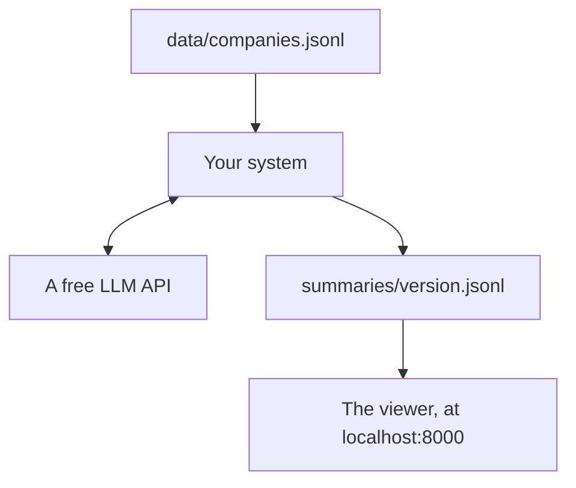

# OneCredit supplier due diligence summaries

The priority-rule system covered 44 of 45 predefined facts on 15 held-out synthetic companies. The revised hybrid covered 42 and the basic template covered 37. The complete experiment includes 50 company briefs for each full method, four before-and-after pilot cases, raw model responses and the original viewer. [Read the case study](CASE_STUDY.md)

## Run the submission

From the repository root, install the locked Python 3.14 environment. The generation and evaluation code uses the Python standard library.

```bash
uv sync --locked
uv run --locked python -m solution.audit
uv run --locked python -m solution.run baseline
uv run --locked python -m solution.run pilot
uv run --locked python -m solution.run rules
uv run --locked python -m solution.run hybrid
uv run --locked python -m solution.evaluate
uv run --locked python -m unittest discover -s tests -v
```

These commands replay the saved model selections. They work offline after setup. Expected held-out results are baseline 37/45, priority rules 44/45 and revised hybrid 42/45. The original pilot covers 5/12. See the individual omissions and reviewer rationales in the evaluation files. [Results](evaluation/results.json) · [Protocol](evaluation/protocol.md) · [Review rows](evaluation/assisted-review.csv)

Start the original viewer with the command below, or use the template's `just up` with Docker. Open the address shown by Uvicorn. Select **Cahaya Seri Catering** and compare **02-pilot-hybrid** with **04-hybrid**. The missing filing and the pending defendant petition show why the revised renderer reserves space for both.

```bash
uv run --locked uvicorn app.main:app --host 127.0.0.1 --port 8000
```

| Inspect | Command or file | What to verify |
|---|---|---|
| Source fields for a brief | `uv run --locked python -m solution.run explain --id SYN-000286` | Match the court case and the filing gap to the JSON pointers. |
| Held-out selection | `evaluation/targets.json` | Each ID has a reason and three stated source facts. |
| Paired reading | `uv run --locked python -m solution.evaluate --packet` | Read each A/B pair against the raw record before revealing the version mapping. |
| Case where the rules lead | Compare **03-priority-rules** with **04-hybrid** for Jaya Prima Travel | The rules retain both the 0.81× current ratio and the operating cash outflow. |
| Case all methods miss | Look up **SYN-000397** in the viewer's Litigation tab | The settled RM 7,427,000 claim is absent from all three full briefs. |

## Reproduce fresh model responses

The measured provider is the local HTTP API of **llama.cpp b8350** running **Qwen2.5-1.5B-Instruct Q4_K_M**. Live inference uses no API key. The committed request and response bodies in `evaluation/responses/` are enough for routine review. A separate run on different hardware can select different facts even at temperature zero. Cache replay reproduces the submitted text exactly.

1. Download the **llama-server** binary for your operating system from release **b8350**, and the file **qwen2.5-1.5b-instruct-q4_k_m.gguf** from the pinned Qwen model revision. Keep the 1.1 GB weights outside the project. [llama.cpp release](https://github.com/ggml-org/llama.cpp/releases/tag/b8350) · [Pinned model download](https://huggingface.co/Qwen/Qwen2.5-1.5B-Instruct-GGUF/resolve/91cad51170dc346986eccefdc2dd33a9da36ead9/qwen2.5-1.5b-instruct-q4_k_m.gguf)
2. Verify the weights' SHA-256 equals `6a1a2eb6d15622bf3c96857206351ba97e1af16c30d7a74ee38970e434e9407e`. Run the following command from the directory containing the weights, with the binary on your PATH. The recorded CPU run used six threads and one processing slot.
3. In a second terminal in the project root, run the generation command below. Its isolated directories preserve the submitted benchmark. The same command resumes after interruption. Each completed response is saved before proceeding.

```bash
llama-server -m qwen2.5-1.5b-instruct-q4_k_m.gguf -a qwen2.5-1.5b-instruct-q4_k_m --host 127.0.0.1 --port 8181 -t 6 -tb 6 -c 4096 -np 1 --no-webui --no-warmup
```

```bash
uv run --locked python -m solution.run hybrid --live --cache-dir local-runs/responses --output-dir local-runs/summaries
```

The prompt, evidence menu, provider identity and generation settings determine the cache key. The model returns two allowed keys, with temperature 0, seed 41 and a maximum of 54 generated tokens. Unknown keys, malformed JSON and truncated responses are rejected. Transient failures get up to three attempts per invocation. A failed run exits with a diagnostic, preserves completed responses and publishes a viewer file only after every expected row succeeds.

## Experiment files

| File | Purpose |
|---|---|
| `solution/evidence.py` | Financial calculations, source pointers, ownership and role-aware court evidence |
| `solution/model.py` | Actual chat-completions request, response validation, retries and replay |
| `solution/run.py` | Baseline, pilot, rules-only and revised hybrid generation |
| `solution/audit.py` | Counts, missing values, balance checks and period coverage |
| `solution/checks.py`, `solution/evaluate.py` | Checks against raw source values, paired reading and weighted scores |
| `evaluation/` | Frozen sample, protocol, corrected reference, audit, original API responses and results |
| `tests/` | Numeric, date, role, validation, repeatability and API failure regressions |

The starting point was OneCredit's **ds-v2026.11**, commit `7461e0760bf0b5ab874e4d53f349ea51a39b29ea`. The source data, viewer, dependency lockfile and Docker configuration are retained. The viewer was exercised with Uvicorn. All four version endpoints loaded, and a JavaScript DOM test exercised company search, both version selectors, Markdown and the source tabs. Docker was unavailable in the assessment workspace.

## Time budget and walkthrough

The official allocation is 6–8 hours with an eight-hour stop. This plan budgets seven hours, leaving one hour for unexpected problems. The durations are planning allowances. For this assisted run, the local checkout began at 19:58 MYT on 22 November 2026, the rubric was recorded at 20:04, and evaluation and viewer checks were underway by 20:21. Earlier planning conversations and candidate review time are outside these measurements.

| Priority | Budget | Question to be ready to answer |
|---|---:|---|
| Inspect repository and audit data | 45 min | Why would a two-year gap make a year-on-year figure misleading? |
| Define rubric and freeze cases | 45 min | Why select difficult and routine cases before reading any generated text? |
| Engineer features and basic template | 90 min | How can a reviewer trace a figure to the original company and financial year? |
| Run the model pilot and full versions | 90 min | Which decisions belong to the model and what happens when its response fails validation? |
| Evaluate, inspect errors and compare rules | 90 min | Which improvement came from mandatory disclosures, and where did a model still miss something? |
| Document, replay, test and practise | 60 min | Why recommend the rules first, and what human evidence could change that decision? |

---

# DS Take-Home: Company Summaries

**tl;dr:** Build a system that writes a short summary of a company, then write a case study on how you built it and how you know it works. We give you 50 companies, and you can use all of them or just a sample. Plan for 6 to 8 hours, ideally over a weekend. Free LLM APIs are all you need.

**Who it's for:** early-career data scientists with 0 to 2 years of experience. Fresh graduates are very welcome.

If you're not applying and just want to try it, go for it. We hope you learn something new.

## What to submit

1. A **public** repo made from this template. Click **Use this template** → **Create a new repository**, and call it
   whatever you like.
2. Your summaries in [`summaries/`](summaries/), one `<version>.jsonl` file per version ([format](#the-viewer)).
3. A `CASE_STUDY.md` at the top level of your repo, with these headings:
   1. What a good summary is for this team, and why
   2. What you built
   3. How you know whether it's good
   4. What you'd do next, and how you'd keep improving it
4. The [submission form](https://docs.google.com/forms/d/e/1FAIpQLSdjCsXP5jFrKrIi4krLVS8Sq0rhM4mLlhycpsAo34sSj4h3FA/viewform), with a link to your repo and your résumé.

## How we score

- How you decided what a good summary is.
- How you know your system is good.
- How clearly you explain your work and what you'd do next.

Stop at 8 hours. If you run out of time, write down what you'd do next. An honest "here's what's left" counts in
your favour, and we don't expect a perfect or finished solution.

## The problem

A team vets companies before picking them as suppliers or project partners. For every company they read a long
record: its profile, its directors and shareholders, up to three years of financials, and any court cases. That takes
a while. They'd like a short summary to read first, so they can decide whether a company is worth a closer look.

```
┌────────────────────────────────────────────────────────────────────────────────┐
│  Cahaya Seri Catering Sdn. Bhd.                                   SYN-000286   │
│  Food & Beverage · Sabah                                                       │
│  Overview & Relationships   Directors & Shareholders   Financials   Litigation │
├────────────────────────────────────────────────────────────────────────────────┤
│                                                                                │
│  Summary                                                                       │
│  ┌──────────────────────────────────────────────────────────────────────────┐  │
│  │                                                                          │  │
│  │          What your system writes about this company goes here.           │  │
│  │                                                                          │  │
│  └──────────────────────────────────────────────────────────────────────────┘  │
│                                                                                │
│  The full record: profile, people, financials and court cases                  │
│                                                                                │
└────────────────────────────────────────────────────────────────────────────────┘
```

## Your task

Build a system that writes that summary for the companies in [`data/companies.jsonl`](data/companies.jsonl). How
would you build it, experiment with it and evaluate it? Do it, then tell us about it in your `CASE_STUDY.md`.

There are 50 companies, but you don't have to use them all. If a sample suits your plan or your model's limits, use a
sample, and tell us in your case study which companies you picked and why.

What makes a summary good is up to you. Working that out is part of the problem, and there isn't one right answer.
We'd rather see one idea taken all the way than lots of ideas started.



## Models

Use any free LLM API. [awesome-free-llm-apis](https://github.com/mnfst/awesome-free-llm-apis) lists providers with
free tiers, and most of them don't need a credit card. Free tiers are small and change often, so check a provider's
limits when you sign up and plan your runs around them.

To help you plan: one company's record is about 2,000 tokens, so a pass over all 50 is roughly 100,000 tokens. That
goes up two or three times if your model reasons before it answers, or if you use a model to check the output. On a
lot of free tiers, that's most of a day's allowance. Save every response you get back, so you can score your
summaries again without calling the model again.

A paid key is fine too, and it won't change your score. Tell us which provider and models you used in your case
study.

## Getting started

You need Docker, [uv](https://docs.astral.sh/uv/) (it installs Python 3.14 for you) and
[just](https://github.com/casey/just). Setup takes about 5 minutes and doesn't count towards your time. The first
`just up` also downloads the app image, which can add a minute.

```bash
just setup      # install the dependencies on your machine
just up         # start the viewer at http://localhost:8000
just down       # stop it
just lint       # check the viewer's code (app/) with Ruff and Pyrefly
```

If port 8000 is taken, set `APP_PORT` before `just up`. `just lint` only checks the viewer, and nothing runs it
automatically, since this repo has no CI.

If the setup itself is broken (Docker, the viewer or the data won't start), open a
[Setup problem](https://github.com/OneCreditMY/ds-take-home/issues/new?template=setup-problem.yml) issue. Issues are public, so please leave
your solution and personal details out of it.

## The viewer

The viewer shows each company's record with your summaries next to it. Save each version of your summaries as its
own file in [`summaries/`](summaries/), named `<version>.jsonl`, with one line per company:

```json
{"registrationNumber": "SYN-000029", "summary": "Your summary, in Markdown"}
```

Refresh the page to see a new file, and pick a second version to compare the two side by side. The viewer only reads
files and never calls a model. Its code is in [`app/`](app/), and you can change it as much as you like.

## The data

[`data/companies.jsonl`](data/companies.jsonl) has one company per line, 50 in all, and the records are as of
31 December 2025.

| Field | What's in it |
|---|---|
| `registrationNumber` | The company's ID: `SYN-` and six digits. |
| `profile` | Name, status, type, incorporation date, industry, state, nature of business, share capital and former names. |
| `relationships` | Directors (designation and appointment date) and shareholders (people or companies, with their percentage). People are named by role, such as `Director 1` or `Shareholder 2`; a director who also holds shares has the same name in both lists. |
| `financials.years` | Each financial year's audit firm and opinion, `statements` (amounts in RM) and `ratiosAndMetrics`: ratios as decimals (0.12 is 12%) in four groups, profitability, liquidity and cash flow, operational efficiency, and capital structure. A ratio is `null` when it can't be calculated. |
| `litigation.cases` | Court cases: case number, whether the company is the plaintiff or the defendant, type, court, filing date, status and claim amount in RM. |

## What's already here

```
.
├── data/companies.jsonl   # the records for 50 synthetic companies, one per line
├── summaries/             # your system's summaries, one file per version
├── app/                   # the viewer: a small FastAPI backend and one HTML page
├── docker-compose.yml     # runs the viewer, reloading when app/ changes
└── Justfile               # setup, up, down, lint
```

Write your solution in Python, in this project's environment. Add any libraries you need with `uv add`.

## Using AI tools

Go ahead. Just tell us in your case study which tools you used and what for. In the interview we'll ask you to walk
us through your work, so make sure you understand everything you hand in.

## After you submit

- We'll review your work as soon as we can.
- If we move forward, the next interview is a short presentation of your case study (as a slide deck), then
  questions.
- Either way, you'll get written feedback by email.
- Your repo stays yours. Keep it public as a portfolio piece if you like.

## About the data

Everything in this repo is synthetic. We made it up for this assessment.

- The companies, registration numbers, financial figures and court cases are all invented. Any resemblance to a real
  company is a coincidence.
- People and audit firms have placeholder names, like `Director 1` and `Audit Firm 3`, never real ones.
- There's no OneCredit customer, credit or production data in this repo, and none was used to create it.
- Registration numbers (`SYN-`) and case numbers (`CASE-`) use made-up formats, so they can't be mistaken for real
  Companies Commission of Malaysia (SSM) or court numbers.
- Your copy is public, so keep secrets, credentials and personal data out of it.

Assessment version: **2026.11** (`ds-v2026.11`). You can see what changed between versions in
[`CHANGELOG.md`](CHANGELOG.md).
